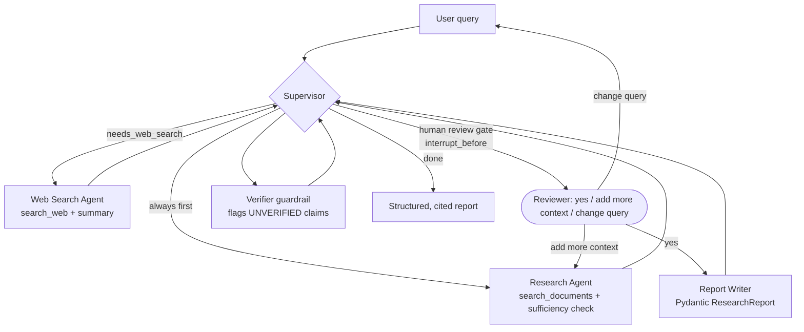
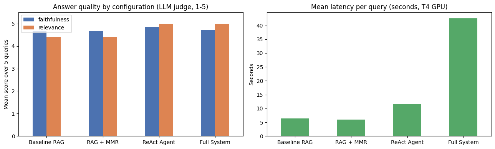
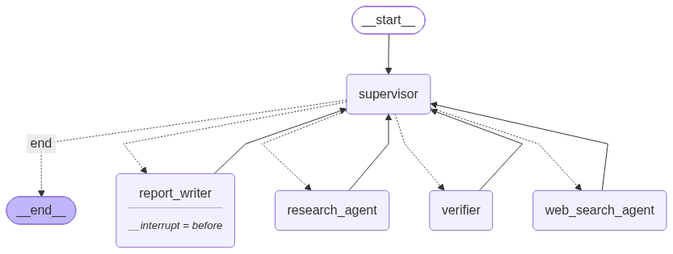

# Lakehouse Research Assistant (GenAI + RAG + Agents)

**Asit Kar** · Post Graduate Program in AI and Machine Learning (UC Berkeley Executive Education / Emeritus) · Mini project, weeks 35–36

An intelligent research assistant for **data engineering and lakehouse architecture**. It ingests 13 foundational systems papers, answers questions grounded in them with page-level citations, searches the web when the papers fall short, and writes structured, verified research reports. Everything runs on **free, local models** (Ollama on a Colab T4 GPU) and needs no API keys.

| Deliverable | File |
|---|---|
| Solution notebook (all 17 tasks, executed) | [`MiniProject_solution.ipynb`](MiniProject_solution.ipynb) |
| Project report (2–3 pages) | [`MiniProject_report.md`](MiniProject_report.md) |

## Architecture

| Layer | Choice |
|---|---|
| Generator and agents | `qwen2.5:7b` via Ollama (`ChatOllama`) |
| Evaluation judge | `llama3.1:8b`, a different model family so the generator never grades itself |
| Embeddings | `sentence-transformers/all-MiniLM-L6-v2` (384-d, normalised, cosine) |
| Vector store | Chroma, persisted to disk |
| Web search | `ddgs` metasearch (several backends) with a Wikipedia API fallback |
| Orchestration | LangChain 1.x (LCEL, `create_agent`), LangGraph (`StateGraph`, `MemorySaver`, `interrupt_before`) |

## Corpus

The PDFs are downloaded at run time from the authors' or venues' sites and are not redistributed in this repo.

| Paper | Venue |
|---|---|
| MapReduce: Simplified Data Processing on Large Clusters | OSDI 2004 |
| The Google File System | SOSP 2003 |
| Bigtable: A Distributed Storage System for Structured Data | OSDI 2006 |
| Dremel: Interactive Analysis of Web-Scale Datasets | VLDB 2010 |
| Resilient Distributed Datasets | NSDI 2012 |
| Spark SQL: Relational Data Processing in Spark | SIGMOD 2015 |
| Structured Streaming | SIGMOD 2018 |
| Automating Large-Scale Data Quality Verification (Deequ) | VLDB 2018 |
| Delta Lake: High-Performance ACID Table Storage over Cloud Object Stores | VLDB 2020 |
| Lakehouse: A New Generation of Open Platforms | CIDR 2021 |
| Photon: A Fast Query Engine for Lakehouse Systems | SIGMOD 2022 |
| Analyzing and Comparing Lakehouse Storage Systems (LHBench) | CIDR 2023 |
| Data Lakes: A Survey of Functions and Systems | arXiv 2106.09592 |

## Results (final run, Colab T4)

| Area | Result |
|---|---|
| Retrieval (Task 5) | Hit Rate@4 = 1.0 and MRR = 1.0 on 10 named and 10 paraphrased questions (similarity, k = 4, 1000/200 chunks) |
| Prompting (Tasks 7–8) | Role-based prompt scored best (4.80 / 5). Few-shot raised bullet-point structure from 0% to 90%, with citations at 100% |
| ReAct agent (Task 10) | Qwen 2.5 7B handled all 4 query types (documents only, documents + web, web only, ambiguous). Llama 3.1 8B handled 1–2 |
| Full system (Task 15) | 10/10 retrieval hits, faithfulness 4.82 / 5, 100% valid citations, 58 s and ~4k tokens per report, $0 on a local GPU |
| Ablation (Task 16) | RAG is 6 s, ReAct 11 s, full system 43 s. Only the agentic configurations answer the question that needs current web information |

The executed LangGraph (supervisor-routed, with the review gate before the report writer):

Failure modes and production considerations are discussed in the [report](MiniProject_report.md) and in Task 17 of the notebook.

## How to run

1. Open `MiniProject_solution.ipynb` in Google Colab and select a **T4 GPU** runtime.
2. Run all cells. The first cell installs the Python packages, the second installs Ollama and pulls `qwen2.5:7b` and `llama3.1:8b` (about 10 GB), and the corpus is downloaded automatically. A full run takes about an hour.
3. To use the review gate interactively, call `review_and_run(query)` without `responses=`. It then prompts with `input()`.

Package versions are pinned in the first code cell and in [`requirements.txt`](requirements.txt). `fake_llm.py` is the offline fake chat model used to smoke-test the pipeline during development (`MINIPROJECT_TEST_MODE=1`); it is not needed for a normal run.
